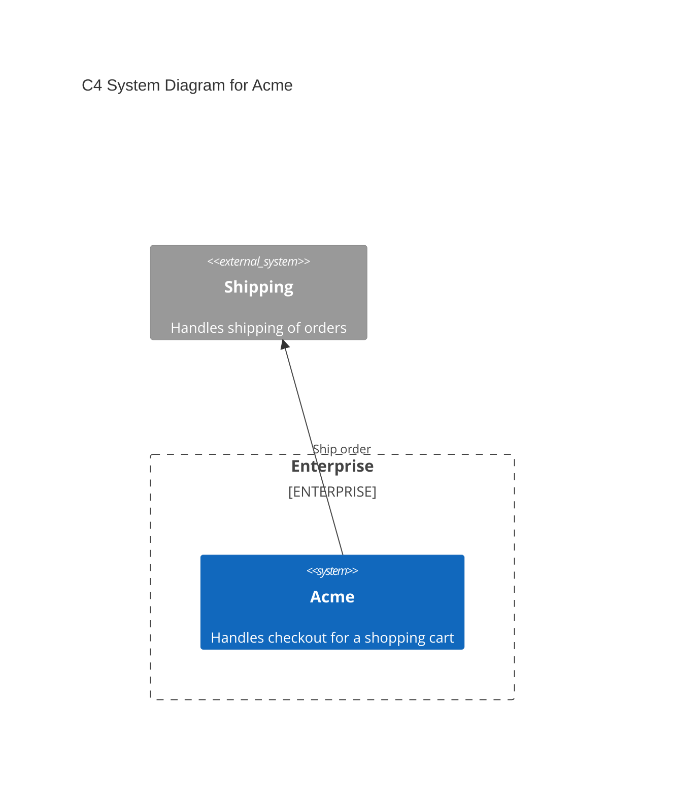
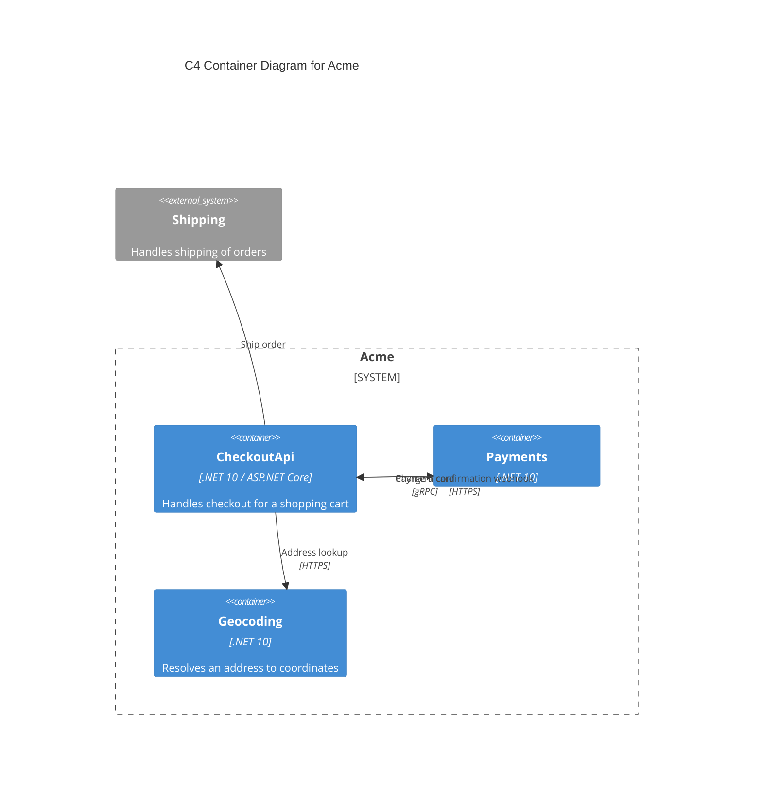

# CRC

This document describes the components, responsibilities, and collaborators for a codebase.

## Responsibilities

|Responsibility|Component|
|---|---|
|Takes payment for an order|[PayForOrder](Checkout/Checkout.cs)|
|Validates delivery addresses|AddressValidator (Acme.Shared::Acme.Shared.AddressValidator)|

## Collaborators

|Collaborator|Component|Description|
|---|---|---|
|Payments|[CardCharger](Checkout/Checkout.cs)||
|Payments|[PaymentWebhook](Checkout/Checkout.cs)||
|Shipping Service|[ShipmentRequester](Checkout/Checkout.cs)|Handles shipping of orders|
|Geocoding|GeocodingClient (Acme.Shared::Acme.Shared.GeocodingClient)|Resolves an address to coordinates|

