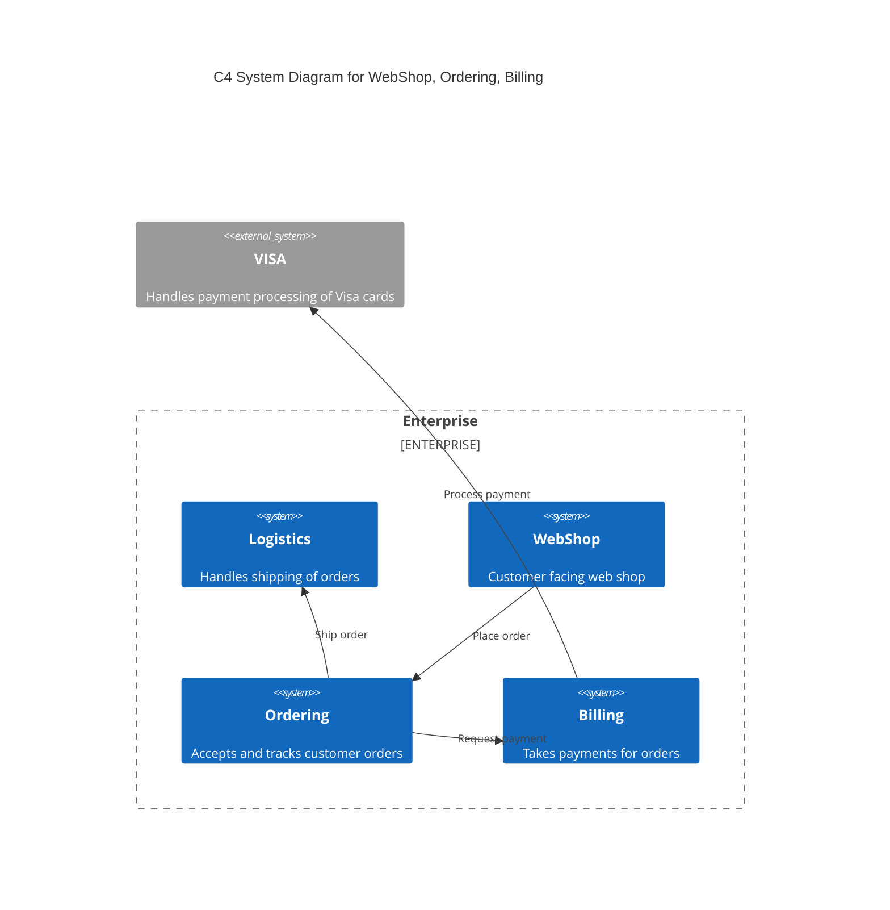

# CRC

This document describes the components, responsibilities, and collaborators for a codebase.

## Storefront

### Responsibilities

|Responsibility|Component|
|---|---|
|Shows the catalog and takes checkout requests|[CheckoutPage](Storefront/Storefront.cs)|

### Collaborators

|Collaborator|Component|Description|
|---|---|---|
|Orders|[OrdersClient](Storefront/Storefront.cs)|Accepts and tracks customer orders|

## Orders

### Responsibilities

|Responsibility|Component|
|---|---|
|Creates and tracks orders|[OrderService](Orders/Orders.cs)|

### Collaborators

|Collaborator|Component|Description|
|---|---|---|
|Storefront|[OrdersController](Orders/Orders.cs)|Customer facing web shop|
|Payments|[PaymentsClient](Orders/Orders.cs)|Takes payments for orders|
|Shipping Service|[ShippingPublisher](Orders/Orders.cs)|Handles shipping of orders|

## Payments

### Responsibilities

|Responsibility|Component|
|---|---|
|Authorises card payments|[PaymentService](Payments/Payments.cs)|

### Collaborators

|Collaborator|Component|Description|
|---|---|---|
|Orders|[PaymentsController](Payments/Payments.cs)|Accepts and tracks customer orders|
|Visa Payment Provider|[VisaAdapter](Payments/Payments.cs)|Handles payment processing of Visa cards|

