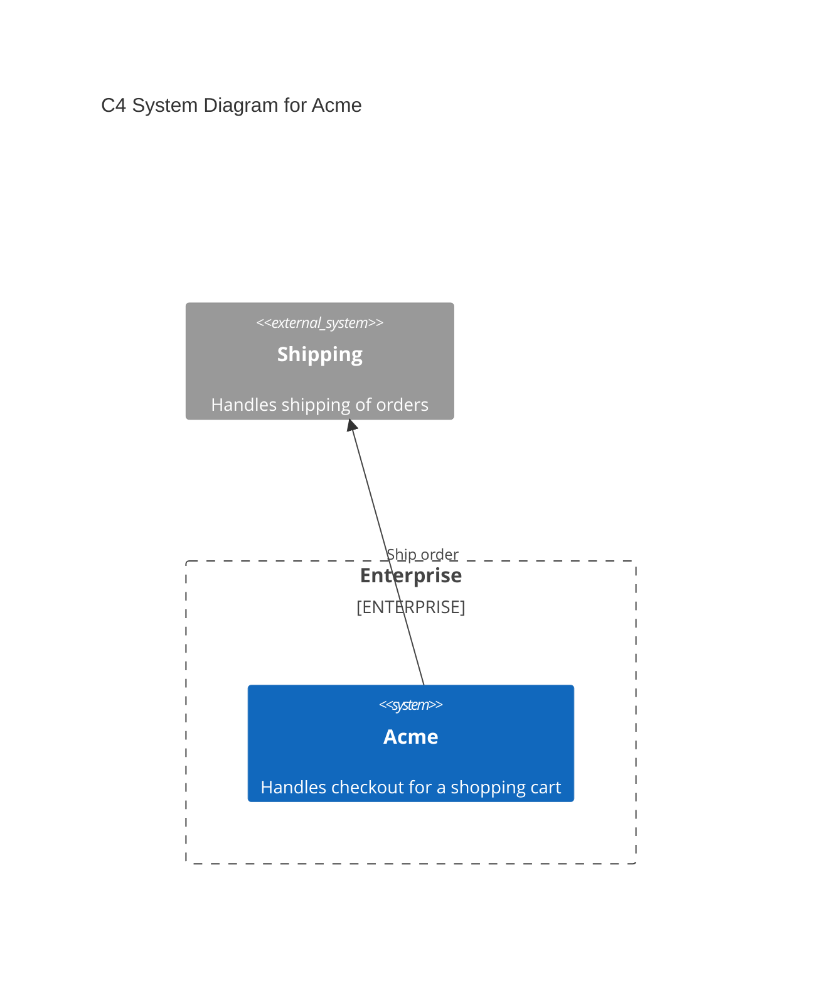
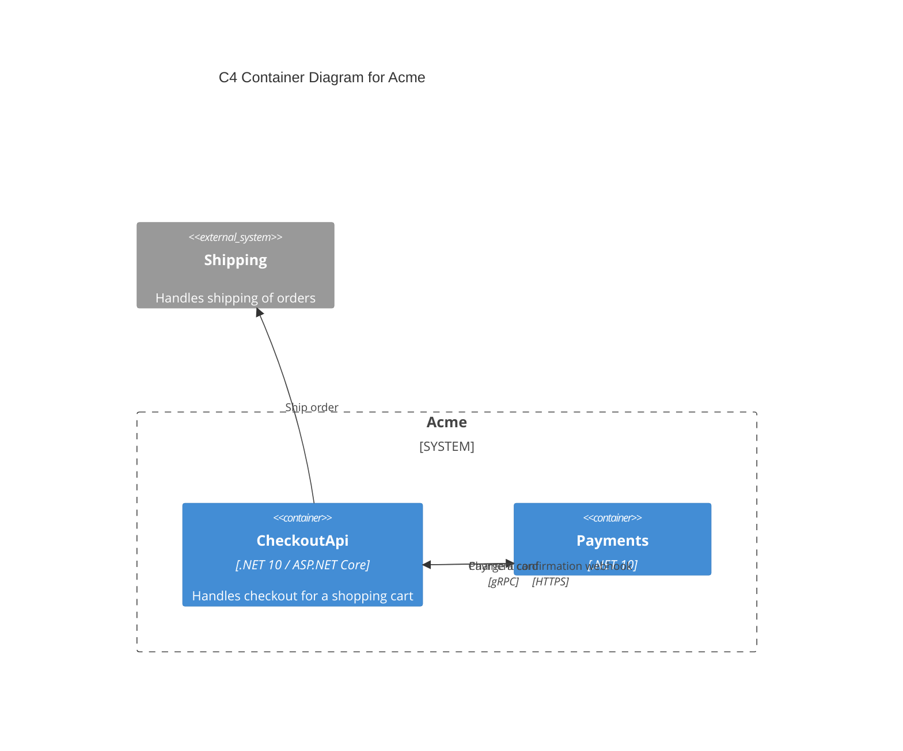

# CRC

This document describes the components, responsibilities, and collaborators for a codebase.

## Responsibilities

|Responsibility|Component|
|---|---|
|Takes payment for an order|[PayForOrder](src/checkout.ts)|

## Collaborators

|Collaborator|Component|Description|
|---|---|---|
|Payments|[CardCharger](src/checkout.ts)||
|Payments|[PaymentWebhook](src/checkout.ts)||
|Shipping Service|[ShipmentRequester](src/checkout.ts)|Handles shipping of orders|

